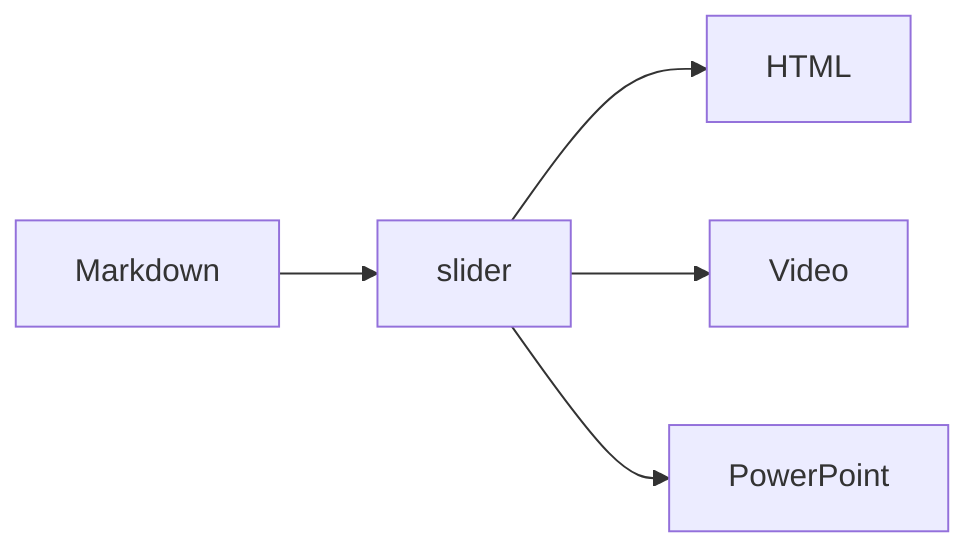

# Diagrams

A fenced block marked `mermaid` is drawn as a diagram.

<!-- voice: A fenced block marked mermaid is drawn as a diagram. Markdown goes into slider, and HTML, video or PowerPoint come out. -->
